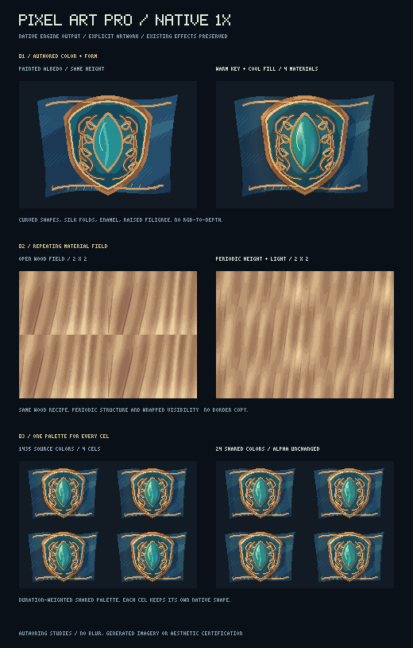

# Pixel Art Lab — 정밀 편집과 애니메이션 제작

이 개선은 기존 곡선·재질·그리기 작업실을 **선택 편집 → 명암 정리 → 프레임 제작 → 게임 자산 출력**까지 연결한다.
기존 이펙트 카탈로그와 기본 렌더링은 유지한다. 새로운 기능은 작업실에서 명시적으로 사용하거나 해당 API를 호출할 때 적용된다.

## 시작하기

```sh
npm ci
npm run build
npm run gallery
```

`http://127.0.0.1:8080/gallery/pixel-art-lab.html`을 연다. 기존 작업실과 동일한 주소다.
PNG와 v1/v2 프로젝트를 계속 열 수 있다. 정지 그림은 v2로 저장되며, 프레임을 만들면 각 v2 문서를 보관하는 v3 애니메이션으로 저장된다.

## 이번에 가능해진 작업

| 작업 | 작업실 기능 | 보존하는 것 |
|---|---|---|
| 얼굴·머리카락·장식의 일부만 고치기 | 사각·타원·올가미 선택, 추가·빼기·교차 | 선택 바깥 원본, 보호 픽셀 |
| 셀을 정확하게 이동·복제·회전 | 드래그, 정수 이동, 좌우·상하 반전, 90° 회전 | RGBA와 실루엣, 재질·높이·법선 |
| 계단형 명암과 하이라이트 직접 작성 | 팔레트 한 단계 밝게·어둡게 브러시 | 팔레트 밖의 색, 알파, 보호 디테일 |
| 펜으로 큰 형태와 작은 선을 함께 작성 | 필압에 따른 정수 붓 크기, 최대 32배 보기, 화면 이동 | 색의 불투명도와 네이티브 좌표 |
| 원화의 여러 색을 유지하며 조명 조정 | 주 광원·보조 광원 색, 단계별 명암, 거칠기, 높이 그림자 | 그린 무늬, 원본 알파와 표면 맵 |
| 연결되는 반복 재질 만들기 | 주기적인 재질 무늬·높이·법선·가림 계산 | 정해진 시드, 색 팔레트, 반복 간격 |
| 프레임마다 픽셀과 시간을 직접 조절 | 프레임 추가·복제·삭제·재정렬, ms 길이, 겹쳐 보기 | 독립 레이어와 표면 맵, 전체 실행 취소 |
| 애니메이션의 색상 일관성 유지 | 전체 프레임 공통 팔레트 추출·적용 | 각 프레임의 알파, 보호 영역 |
| 게임에 바로 넣을 자산 저장 | 네이티브 PNG, 시트 PNG+시간 JSON, SpriteClip JSON | 원본 픽셀, 프레임 순서와 실제 길이 |

## 선택과 변형

오른쪽 결과 캔버스에서 `M` 사각 선택, `Q` 올가미, `V` 이동을 선택한다. 타원 선택은 도구 목록에 있다.
드래그할 때 Shift는 추가, Alt는 제외, Shift+Alt는 교차다. 도구 아래의 선택 방식 메뉴로도 같은 동작을 고를 수 있다.
선택은 투명한 영역도 포함하므로 구멍이 있는 장식이나 배경을 함께 잘라 옮길 수 있다.

이동 도구에서 방향키는 1px, Shift+방향키는 10px 이동이다. 복제 옵션을 켜면 원본을 남기고 변형한 사본만 선택한다.
90° 회전은 선택 경계의 왼쪽 위를 기준으로 가로·세로를 바꾼다. 원형·반원·장신 캐릭터처럼 형태가 길 때도 반 픽셀 보간을 하지 않는다.
법선의 x/y 성분도 같은 방향으로 회전·반전한다.

기본 설정에서 선택이 캔버스 밖으로 나가면 편집 전체를 적용하지 않는다. 명시적으로 **반대편으로 이어 붙이기** 또는 **밖으로 나간 셀 자르기**를 선택할 수 있다.
보호된 목적지와 겹치면 보호 픽셀을 유지하고 변형을 적용하지 않는다. 시작점과 목적지가 겹치는 이동은 원본 스냅샷에서 읽어 색이 번지지 않는다.

변형은 새로운 레이어다. 아래쪽 그림·재질은 편집 가능한 상태로 남으며, 변형 레이어를 숨기거나 순서를 바꾸거나 실행 취소할 수 있다.
같은 선택 영역을 연속으로 조금씩 이동하면 기존 최상위 변형 레이어의 위치를 갱신하므로 방향키를 누를 때마다 레이어가 늘어나지 않는다.
실행 취소는 각 이동 단위를 유지한다. 다른 선택·그림 작업·복제·자르기를 사이에 넣으면 별도 편집으로 보관한다.
원형의 작성 높이는 원본에 보존하고 표시된 변형 순서로 작업용 높이를 다시 계산하므로, 변형을 숨긴 뒤 다른 재질을 추가해도 높이 위치가 어긋나지 않는다.
선택 테두리·격자·이전 프레임 표시는 별도 화면 오버레이이며 PNG와 표면 맵에 포함되지 않는다.

## 한 픽셀의 명암과 필압

**색상 설계**에서 어두운 색부터 밝은 색 순서의 작업 팔레트를 만든 뒤 밝게·어둡게 도구를 사용한다.
브러시는 팔레트에 정확하게 들어 있는 RGB만 한 단계 이동한다. 다른 소재의 색을 가까운 색으로 억지 변환하지 않는다.
한 스트로크가 같은 곳을 지나도 시작 시점의 셀에서 계산하므로 반복해서 밝아지거나 어두워지지 않는다.

이미 선택한 그림 레이어가 있으면 그 레이어의 작성된 셀을 조정한다. 반투명 레이어의 원본 알파를 유지하며 레이어 불투명도를 두 번 적용하지 않는다.
그림 레이어 이외의 레이어를 선택한 상태에서는 현재 결과를 기준으로 새 그림 레이어를 만든다.

펜 필압은 붓의 정수 지름을 바꾼다. 팔레트 색의 알파를 연속적으로 바꾸지 않는다. 마우스 입력은 기존 붓 크기를 유지한다.
`[`와 `]`로 붓 크기를 바꾸고, `+`·`-` 또는 Ctrl/Cmd+휠로 확대·축소한다. `1`은 네이티브 배율이다.
휠 버튼을 누른 채 드래그하면 확대된 캔버스를 이동한다. **작업 화면 확대**는 결과 패널에 넓은 작업 공간을 제공한다.

## 재조명과 반복 재질

재질 레이어나 저장된 표면 맵이 있는 그림에서 **원화 색을 유지하는 재조명**을 연다.
주 광원의 방향·고도와 반대 방향의 보조 광원 색·세기를 재조명 패널에서 조절한다.
주변 밝기, 거칠기, AO, 그림자와 단계 수를 사용하고 적용 강도로 원본과 결과를 조절한다.
이 패널의 값은 재질 생성 설정과 독립적이며, 슬라이더를 움직여도 새 재질 미리보기가 생기지 않는다.
여러 색으로 그린 원화에는 재조명 레이어 하나를 추가한다. 이미 재질을 미리 보고 있으면 그 화면 결과를 함께 확정하므로,
원화에만 조명을 적용하려면 먼저 재질 미리보기를 취소한다.
고정 색 수가 필요하면 **작업 팔레트 안에서 표현**을 선택한다.

재조명은 입력 색을 조명 조정의 기준으로 삼는다. 이미 구워진 그림자의 원래 색을 역으로 복원하는 기능은 아니다.
높이와 법선은 명시한 채널을 사용하며 RGB에서 물체의 깊이를 추측하지 않는다. 효과를 반복 조작해도 아래 레이어부터 다시 계산하므로 변화가 누적되지 않는다.

**캔버스 크기로 반복되는 재질**을 켜면 현재 가로·세로를 무늬의 주기로 사용하고 가장자리 입체감을 0으로 둔다.
전체를 채운 타일에 적용하고 **3×3 타일 확인**으로 경계를 살펴본다. 동일 크기의 완전한 타일에서는 높이·법선·AO·그림자 계산도 반복 경계를 사용한다.
새 캔버스나 재질 레이어 없는 원화를 열면 반복 간격도 새 크기를 따른다. 가로·세로가 모두 2픽셀 이상이어야 하며,
1픽셀짜리 축이 있는 원화를 열면 반복 재질 모드를 해제한다. 이미 저장된 재질 레이어의 명시적 반복 간격은 보존한다.
임의 사진의 양 끝을 붙여 자동으로 수선하는 기능은 아니다. 다른 크기로 잘랐거나 일부만 채운 표면에는 그 실루엣과 잘린 경계가 남을 수 있다.

## 프레임 애니메이션

1. 현재 원화를 그린 뒤 **현재 프레임 복제**를 누른다. 현재 결과와 편집 레이어를 보존한 두 번째 프레임이 생긴다.
2. 이동·변형·그리기로 새 프레임만 수정한다. 빈 프레임으로 시작하려면 **빈 프레임 +**를 누른다.
3. 프레임 카드로 이동하고 이름과 길이를 조절한다. 길이는 밀리초이며 API는 `1000/60` 같은 소수 길이도 지원한다.
4. 겹쳐 보기를 켜면 이전·다음 그림을 색으로 구분해 현재 그림 뒤에 표시한다.
5. 재생을 정방향·역방향·왕복 중 고르고 반복 여부를 설정한다. Space로 재생, 쉼표·마침표로 앞뒤 프레임을 선택한다.
6. 전체 프레임에서 공통 팔레트를 추출한 뒤 필요하면 한 번에 적용한다. 각 프레임에 같은 팔레트 조정 레이어가 생기며 한 번에 실행 취소된다.
7. 프로젝트를 저장하거나 시트·시간 JSON 또는 SpriteClip JSON을 내보낸다.

시트의 각 칸에는 작성된 프레임이 한 번씩 들어간다. JSON에는 시트 좌표, 프레임 시간, 정방향·역방향·왕복의 실제 재생 순서가 별도로 있다.
SpriteClip JSON은 기존 `createSpriteClip2D`에서 사용할 수 있도록 재생 순서를 펼쳐 저장한다. 루프 설정은 JSON의 `source.loop`를 읽어 런타임 옵션으로 전달한다.
PNG는 브라우저 화면의 premultiplied-alpha 읽기 결과를 저장하지 않고 원본 straight RGBA를 직접 인코딩한다.

## 성능과 데이터 보존

- 프레임을 선택하는 작업은 undo 단계를 소비하거나 redo를 지우지 않는다. 편집·프레임 순서·시간 변경은 히스토리에 포함된다.
- 문서가 바뀌지 않으면 재질 미리보기와 진단을 재사용한다. 그리는 동안 무거운 영역 진단을 매 포인터 이벤트마다 다시 실행하지 않는다.
- 재생 전에 색·실루엣을 구워 놓고 시간 샘플러만 진행한다. 매 animation frame에 재질 레이어를 다시 렌더하지 않는다.
- 편집용 전체 래스터는 별도의 32MiB LRU 캐시를 쓴다. 재생의 색·마스크는 합산 네이티브 셀 예산 기준 최대 40MiB이며, 프로젝트·undo·캔버스·내보내기 버퍼는 별도다.
- v3는 최대 256프레임, 합산 8,388,608 네이티브 셀, 16,777,216 저장 값과 64MiB JSON 한도를 검사한다. 해상도·레이어 수에 따라 허용되는 프레임 수가 줄어든다.
- 브라우저 프로젝트는 가로·세로 각각 4096 이하로 열 수 있고, 빈 캔버스 UI는 각각 512 이하로 만든다.
- v1/v2 파일을 계속 읽는다. 새 종류의 레이어나 v3를 예전 버전의 도구에서 여는 역방향 호환성까지 약속하지 않는다.

## 실제 엔진 출력과 검증



위 그림은 기존 이펙트를 변경한 전후 비교가 아니라, 도구의 기능을 확인하기 위해 작성한 별도 원화·반복 재질·공통 팔레트 연구 예제다.
고정 팔레트 없이 여러 색 광원을 쓰면 색 수가 늘어난다. 팔레트 제한을 강하게 걸면 작은 색조 변화가 줄어드는 선택도 직접 확인할 수 있다.

```sh
npm run test:pixel-art
npm run preview:pixel-pro
GPU_BROWSER_PATH=/path/to/chromium npm run test:browser:pixel-pro
```

기존 출력은 기준 메인 `b55a072`와 비교했다. 274개 효과를 각각 5개 시점에서 렌더하고,
색·일반 조명·HDR 조명·최종 RGBA를 라이브러리와 배포용 번들에서 비교한 10,960개 버퍼에 불일치가 없었다.
이 수치는 검사한 샘플의 보존 근거이며 모든 옵션·모든 프레임이나 미술적 완성도를 인증하는 점수가 아니다.

### 구현과 근거

- [선택·변형 API](PIXEL_SELECTION_TRANSFORMS.md)
- [재조명·반복 재질·공통 팔레트](PIXEL_ART_PRO_MATERIALS.md)
- [애니메이션 형식과 API](PIXEL_ART_ANIMATION.md)
- [실제 원본 크기 관찰](previews/pixel-art-pro/visual-review.md)
- [기존 효과의 샘플별 보존 기록](validation/pixel-art-pro-preservation-2026-11-06.json)

공유 사이트의 소스 번들과 카탈로그에도 동일한 작업실을 반영한다. 이번 기능은 CPU 작성·베이크·편집 경로이며,
실제 GPU 처리 속도 향상을 측정하거나 네이티브 게임 엔진 플러그인을 새로 제공한 작업은 아니다.
