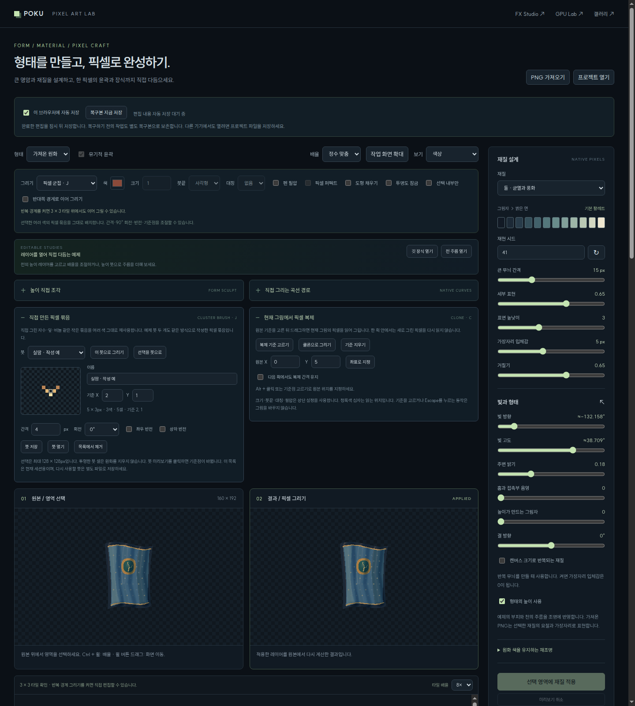
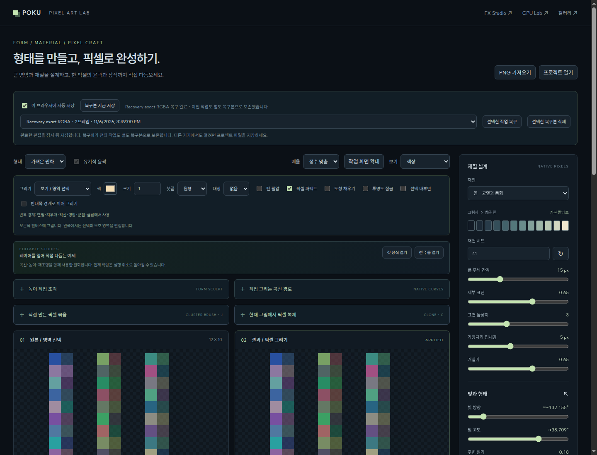
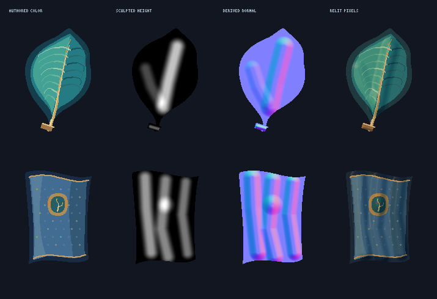

# 픽셀 제작 도구의 실제 브라우저 화면

아래 이미지는 통합 소스 `c38173cd3a7ec3d82f285a499e85ceac268075d2`를 실행한 Chrome의 화면입니다.
레이아웃 목업이나 합성 이미지가 아닙니다.

[CI 실행](https://github.com/Stankjedi/poku-pixel-fx/actions/runs/42246388269) ·
[검사 요약](../../validation/pixel-art-workflow-2026-11-06.json) ·
[원본 브라우저 검사 보고서](../../validation/pixel-art-workflow-browser-2026-11-06)

## 직접 만든 붓과 복제 기준

여러 색의 군집 원본, 기준 셀, 간격·회전·반전, 복제 기준을 조절합니다.
이 화면에 보이는 천은 별도의 편집 가능한 작성 예제입니다. 실제 검사는 이 예제 화면 외에도
포인터 입력으로 군집 배치·겹친 복제·타일 경계 이동을 수행하고, 내려받은 PNG의 RGBA를 독립 기대값과 비교했습니다.

## 새로고침 후 명시적 작업 복구

선택한 복구본을 연 뒤 완료 상태와 이전 작업을 보관했다는 안내가 표시됩니다.
화면의 작은 색 격자는 낮은 알파·숨은 RGB·마스크를 검증하는 입력 자료이며 작품의 미술적 품질을 보여 주기 위한 예제가 아닙니다.
복구 검사는 레코드 삭제, 두 번째 저장 요청 실패, 저장 중 자동 저장 해제, 독립 cel·팔레트, 390px 배치도 확인했습니다.

## 네이티브 형태·높이·법선 비교

각 행은 같은 원화를 색, 직접 조각한 높이, 유도된 법선, 재조명 결과 순서로 보여 줍니다.
[160×192 편집 가능한 원화와 큰 비교 이미지](../pixel-art-craft/)에서 프로젝트 JSON도 받을 수 있습니다.
작성한 경로·높이·원래 픽셀 색의 역할을 각각 확인할 수 있습니다. 큰 비교 이미지는 네이티브 셀을 최근접 방식으로 반복합니다.
