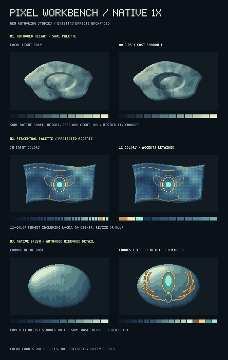

# Pixel Workbench 실제 출력 비교

`tools/preview-pixel-workbench.mjs`로 새 작성 도구를 실행해 만든 비교이다.
기존 이펙트를 수정한 전후 비교가 아니며, 모든 입력 형태·높이·장식은
생성 스크립트에 명시되어 있다. 외부 이미지나 이미지 생성 서비스를 사용하지 않았다.

- [원본 1× 비교](comparison-native.png)
- [최근접 3× 비교](comparison-3x.png)
- [원본 1× 표면 맵](surface-maps-native.png)
- [최근접 3× 표면 맵](surface-maps-3x.png)
- [입력·옵션·보존 여부·파일 해시](evidence.json)



## 직접 확인한 내용

아래 관찰은 생성한 **1×와 3× 비교 이미지를 실제로 열어 확인한 기록**이다.
셀 수와 보존 여부는 별도로 `evidence.json`에 기록한 버퍼 비교 결과이다.

### 1. 같은 바위에 추가한 높이 기반 음영

두 이미지의 실루엣, 높이, 표면 법선, 시드, 광원과 12색 팔레트는 같다.
오른쪽에서 주변광 차폐와 자체 그림자만 켰다.

1×에서도 홈의 한쪽 안쪽 테두리가 더 어두워져 파인 형태가 뚜렷해진다.
3×에서는 어두운 영역이 바위 외곽을 새로 만들지 않고 기존 홈의 경계를
따르는 것을 확인했다. 색 경계는 기존 팔레트의 픽셀 단위로 남아 있으며
블러로 번지지 않는다.

이 예제에서 색이 달라진 셀은 1,223개이다. 알파·실루엣·높이·법선은
모두 동일하다. 표면의 큰 색 덩어리와 외곽은 공통 입력이므로 새 음영
기능이 형태를 자동으로 다시 그렸다고 해석하면 안 된다.

### 2. 자수를 보호한 팔레트 축소

32단계로 작성한 천 명암 팔레트와 세 가지 장식색을 사용한 입력에서
실제로 사용된 색은 30색이었다. 같은 픽셀을 12색으로 다시 매핑했고,
금색 윤곽과 청록색 중앙 장식은 잠금색과 보호 마스크로 유지했다.

1×에서 천의 큰 주름과 자수 위치가 유지된다. 3×에서는 팔레트 축소로
직조 무늬와 명암 경계가 더 굵게 구분되고, 일부 미세한 중간 명암이
사라지는 차이도 보인다. 따라서 이 비교는 **정해진 색상 예산으로의
변환과 디테일 보호**를 보여주며, 색을 줄일수록 항상 좋아진다는
주장은 아니다. 디더링은 사용하지 않았다.

보호한 660개 셀의 픽셀은 원본과 같으며 알파와 실루엣도 같다.

### 3. 직접 작성한 대칭 곡선과 작은 장식

두 이미지가 같은 둥근 금속 바탕을 사용한다. 오른쪽에 3셀 폭의
밑칠, 정리된 1셀 곡선, 타원형 장식을 명시적으로 그렸다.

1×에서 양옆의 곡선과 중앙 장식을 구별할 수 있고, 3×에서는 곡선을
따른 계단 간격과 한 셀 강조선을 확인할 수 있다. 미러 축은 짝수 폭
캔버스의 두 중앙 열 사이인 x=95.5이다. 그림자나 주변 재질을 흐리는
후처리는 사용하지 않았다.

총 13개의 작성 작업이 2,088개 셀의 색을 바꿨다. 실제 편집 마스크는
좌우 대칭이고, 알파 잠금으로 바탕의 실루엣과 알파를 유지했다.
장식의 의미와 배치는 스크립트에 작성한 것으로, 도구가 원화의 의도를
자동 추론한 결과가 아니다.

### 표면 맵

높이 맵에서 원형 홈이 주변 표면보다 낮게 나타나고, 법선 맵에는
그 경계의 방향 변화가 보인다. 주변광 맵의 음영은 홈 둘레에 집중되며,
방향광 맵에서는 홈 한쪽에 초승달 모양의 차폐 영역이 보인다.
원본 실루엣 밖은 투명하다.

법선 PNG는 OpenGL의 y-up 규약이고 높이 PNG는 고정 범위 `0..20`을
사용한다. 회색은 데이터 값이며 일반 사진의 색 보정 대상이 아니다.

## 재현

저장소 루트에서 실행한다.

```sh
npm run build
node tools/preview-pixel-workbench.mjs
```

기본 출력 위치는 이 폴더이다. 출력 폴더를 첫 번째 인자로 지정할 수도 있다.
네이티브 개별 이미지는 모두 192×112픽셀이며, 확대 비교는 각 원본 픽셀을
정확히 3×3셀로 반복한다. 리사이즈 보간·안티앨리어싱·블러를 사용하지 않는다.

`evidence.json`에는 생성 시점 커밋, 실제 소스와 빌드 모듈의 SHA-256,
입력 높이 해시, 옵션, PNG와 RGBA 해시를 기록했다. 색 수·변경 셀 수는
기술적 비교 정보이며 미술적 품질을 인증하는 점수가 아니다.
